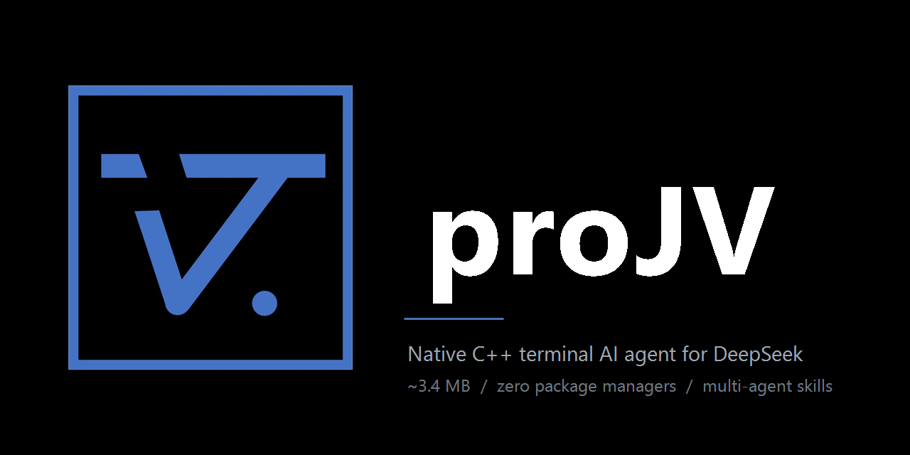
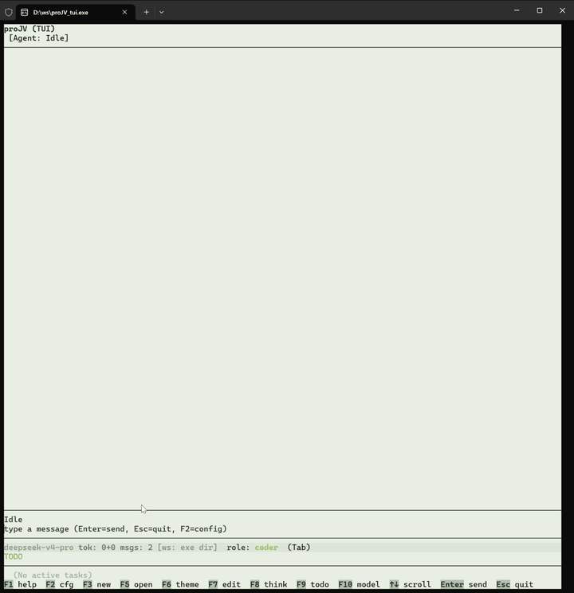

<h1 align="center">proJV</h1>

  

  <b>English</b> | <a href="README_zh.md">简体中文</a>

  A native C++ AI agent for the terminal, built on DeepSeek. 
  <code>proJV = Project Just Vibing</code>

  
  
  
  
  
  

  

  <b>Every line of code in proJV was written by proJV.</b>

---

## Three things that make it different

- **Native C++, ~3.4 MB, zero package managers.** FTXUI + libcurl + SQLite, all
  vendored. One `cmake --build` and you have a single binary you can scp.
- **Multi-agent skills are data, not code.** A skill is a folder:
  `config.json` + one `.md` per role + verb tool schemas. Copy it in — it runs.
  A supervisor can fan one reply out to ten workers that execute concurrently.
- **Every layer is yours.** Roles, tools, prompts, themes, the compaction
  strategy, Python tools — all plain files next to the binary. No locked
  ecosystem.

---

## Start in three steps

1. **Download** the release for your platform from
   [Releases](https://github.com/MilesKHuang/proJV/releases) and unpack it
   (`proJV_tui` + `projv_files/` must stay together).
2. **Paste your DeepSeek API key** into the config dialog on first launch
   ([get one](https://platform.deepseek.com/api_keys)).
3. **Type a message.** Ask it to read a file, fix a bug, or run
   `/monica D:\path\to\project`.

Windows may warn about the unsigned binary (SmartScreen -> "More info" ->
"Run anyway"). Linux needs `libcurl4-openssl-dev` if you build from source.

Prefer to build? -> [install guide](docs/en/user-guide/01-install.md)

---

## Installs as a command, reports to the terminal

| What | Why you care |
|---|---|
| **`projv` on PATH** | `proJV_tui --install` writes a four-line forwarder - no admin rights - so `projv` runs from any directory in cmd, PowerShell or a shell. `--uninstall` removes only the forwarder, `--purge` the install directory; your config and sessions are never touched. |
| **OSC 7501 status** | proJV reports `working` / `blocked` / `done` to the host terminal, so Windows Terminal, Ghostty or cmux can paint it on the tab. A redirected stdout gets no extra bytes; `osc_status = false` or `PROJV_NO_OSC=1` switches it off |
| **Ostlr** | the companion multi-window agent manager reads that same status, so a proJV session shows up there as a first-class agent - no glue code on either side |

---

## What it can do

| Capability | Detail |
|-----------|--------|
| **Tool orchestration** | read / write / edit files, targeted line ranges, directory trees, regex grep, shell, todo, skills — the model decides |
| **Skills** | `/monica <dir>` (10 concurrent workers tidy up a repo), `/bigbang` (three-role debate -> one execution doc), `skill_maker` authors new ones |
| **Vision input** | `@path` attaches screenshots or images; directories expand to their images |
| **Thinking chain** | reasoning streamed live, collapsible, `F8` for the full trace; `reasoning_effort` sets the depth (none / low / high / max) |
| **1M context** | the full DeepSeek V4 1M-token window, with automatic compression when pressure builds |
| **Web** | DeepSeek's own Search and Fetch APIs (structured results, Markdown pages) |
| **Sessions** | SQLite per conversation, crash-safe, `/compress` to shrink long ones |
| **Terminal status** | reports `working` / `blocked` / `done` to the host terminal over **OSC 7501** (Program Status Protocol), so Windows Terminal, Ghostty or Ostlr can show a tab badge; a redirected stdout gets no extra bytes, `osc_status = false` or `PROJV_NO_OSC=1` turns it off |
| **Themes** | 2 built-in + 6 curated, visual editor with live preview, JSON import/export |
| **Python tools** | drop a folder with `tool.json` + `main.py` and the agent can call it |
| **Cost awareness** | live token counts and a price estimate from `config.toml` |

Details -> [user guide](docs/en/user-guide/README.md) · [skills](docs/en/user-guide/06-skills.md) · [pytool](docs/en/user-guide/07-pytool.md)

---

## How it compares

Facts verified 2026-10-25; `—` means "not checked here". proJV column reflects
this repository.

| | proJV | Claude Code | OpenAI Codex CLI | Aider |
|---|---|---|---|---|
| Implementation | C++20 | TypeScript (Node) | Rust | Python |
| Install | one binary, deps vendored | npm | npm / brew / release | pip |
| Runtime needed | none | Node.js | none (npm wrapper) | Python |
| Multi-agent | data-driven skill folders, workers run concurrently | subagents | TOML subagents | — |
| Extending | drop files: skills, roles, themes, Python tools; MCP servers via `mcp.json` | MCP servers, hooks | MCP, plugins | — |
| Model choice | DeepSeek only | Anthropic | OpenAI | many providers |
| Cost model | DeepSeek per-token pricing | subscription or API | ChatGPT plan or API | provider-dependent |

Deliberately narrow: proJV does one model provider well and puts the extension
surface in plain files instead of a plugin registry.

---

## Where to go next

| You want to | Go to |
|-------------|-------|
| use it daily | [user guide](docs/en/user-guide/README.md) |
| run or write skills | [skills](docs/en/user-guide/06-skills.md) |
| define your own workflow | [authoring a skill](docs/en/user-guide/09-skills-authoring.md) |
| change the code | [dev guide](docs/en/dev-guide/README.md) · [module map](docs/en/dev-guide/module-map.md) · [recipes](docs/en/dev-guide/recipes.md) |
| contribute | [CONTRIBUTING](CONTRIBUTING.md) |

---

## Why these choices

**Native C++ and a terminal UI.** Small binary, no runtime, runs over SSH and in
tmux, and lets you call system APIs directly. When something genuinely needs a
big library, a Python tool covers it.

**MCP is a config line, not a plugin system.** A built-in tool is still a struct
with a JSON schema and a function, and a pytool is still a file in a folder. What
`projv_files/mcp.json` adds is a third way to get a tool: point it at an external
process and proJV talks to it over stdio JSON-RPC, the same way `exec_shell` talks
to a command -- except the process stays alive between calls. Nothing is loaded
as code, no registry is consulted, no package manager is involved. If a few dozen
lines of pytool do the job, write the pytool; reach for MCP when the tool already
exists as an MCP server.

**DeepSeek (for now).** It is simply very cheap for an agent that reads and
writes files all day, which makes multi-agent runs affordable.

---

## Credits

[DeepSeek](https://deepseek.com) · [FTXUI](https://github.com/ArthurSonzogni/FTXUI)
· [SQLiteCpp](https://github.com/SRombauts/SQLiteCpp) · [libcurl](https://curl.se/)
· [loguru](https://github.com/emilk/loguru) · every open-source maintainer whose
work made this possible.

## Support

If proJV saves you time, a coffee is appreciated (WeChat):

  

