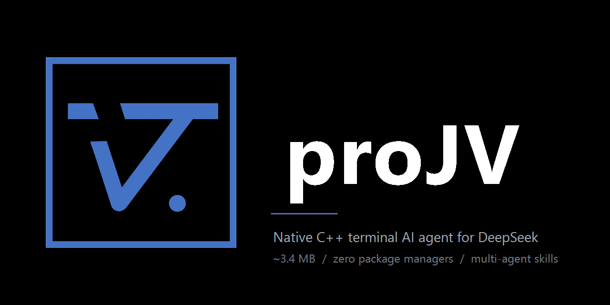
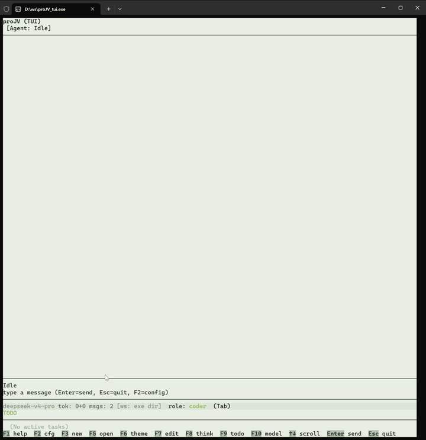

# proJV

  

**简体中文** | [English](README.md)

`proJV = Project Just Vibing` —— 一个原生的 C++ 终端 AI agent，基于 DeepSeek。

**proJV 里的每一行代码都是 proJV 自己写的。**

---

## 三个不一样的地方

- **原生 C++，约 3.4 MB，零包管理器。** FTXUI + libcurl + SQLite 全部内置，
  一次 `cmake --build` 就得到一个能直接 scp 的单文件二进制。
- **多 agent 技能是数据，不是代码。** 一个技能就是一个文件夹：`config.json` +
  每个角色一个 `.md` + 动词级工具 schema。扔进去就能跑，一个调度者可以把一次
  回复派给十个并发执行的 worker。
- **每一层都是你的。** 角色、工具、提示词、主题、压缩策略、Python 工具
  —— 全是二进制旁边的普通文件，没有封闭生态。

---

## 三步用起来

1. **下载**对应平台的发布包并解压
   （[Releases](https://github.com/MilesKHuang/proJV/releases)；`proJV_tui` 和
   `projv_files/` 必须放在一起）。
2. **填 DeepSeek API Key**：首次启动的配置窗里粘贴
   （[在这里申请](https://platform.deepseek.com/api_keys)）。
3. **发一条消息**：让它读文件、改 bug，或者跑 `/monica D:\path\to\project`。

Windows 可能提示二进制未签名（SmartScreen ->「更多信息」->「仍要运行」）。
Linux 自行编译时需要 `libcurl4-openssl-dev`。

想自己编译？-> [安装指南](docs/zh/user-guide/01-install.md)

---

## 装成一条命令，还能向终端汇报状态

| 什么 | 为什么值得在意 |
|---|---|
| **把 `projv` 装进 PATH** | `proJV_tui --install` 只写一个四行转发器，不需要管理员权限；之后在 cmd、PowerShell 或任意 shell、任意目录敲 `projv` 就能起来。`--uninstall` 只删转发器，`--purge` 删安装目录；你的配置和会话永远不动。设计文档：[`docs/archive/projv-install.md`](docs/archive/projv-install.md) |
| **OSC 7501 状态** | proJV 把 `working` / `blocked` / `done` 报给宿主终端，Windows Terminal、Ghostty、cmux 可以直接画在标签上。输出被重定向时一个字节都不多写；`osc_status = false` 或 `PROJV_NO_OSC=1` 可关闭 |
| **配套 Ostlr** | 多窗口 agent 管理器，读的就是这份状态：proJV 会话在 Ostlr 里是原生可见的 agent，两边都不需要胶水代码 |

---

## 能做什么

| 能力 | 说明 |
|------|------|
| **工具调度** | 读写改文件、按行区间读取、目录树、正则搜索、shell、todo、技能 —— 由模型决定 |
| **技能** | `/monica <目录>`（十个 worker 并发整理项目）、`/bigbang`（三方圆桌辩论 -> 一份执行文档）、`skill_maker` 自动生成新技能 |
| **图片输入** | `@路径` 附加截图或图片；给一个目录会自动展开其中的图片 |
| **思考链** | 实时流式显示、可折叠，`F8` 看完整思考；`reasoning_effort` 控制深度（none / low / high / max） |
| **1M 上下文** | DeepSeek V4 完整的 1M token 窗口，压力高时自动压缩长会话 |
| **网页** | DeepSeek 官方 Search / Fetch API（结构化结果、Markdown 页面） |
| **会话** | 每个对话一个 SQLite，崩溃不丢，`/compress` 压缩长会话 |
| **终端状态** | 通过 **OSC 7501**（Program Status Protocol）向宿主终端上报 `working` / `blocked` / `done`，Windows Terminal、Ghostty、Ostlr 都能在标签上显示；输出被重定向时不多写一个字节，`osc_status = false` 或 `PROJV_NO_OSC=1` 可关闭 |
| **主题** | 2 个内置 + 6 个精选，可视化编辑器带实时预览，JSON 导入/导出 |
| **Python 工具** | 放一个含 `tool.json` + `main.py` 的目录，agent 就能调用 |
| **成本可见** | 实时 token 数与 `config.toml` 里价格表的费用估算 |

细节 -> [用户指南](docs/zh/user-guide/README.md) · [技能](docs/zh/user-guide/06-skills.md) · [pytool](docs/zh/user-guide/07-pytool.md)

---

## 和别人的区别

事实核对于 2026-10-25；`—` 表示「这里没验证」。proJV 一列以本仓库为准。

| | proJV | Claude Code | OpenAI Codex CLI | Aider |
|---|---|---|---|---|
| 实现 | C++20 | TypeScript（Node） | Rust | Python |
| 安装 | 一个二进制，依赖内置 | npm | npm / brew / release | pip |
| 运行时 | 不需要 | Node.js | 不需要（npm 包装） | Python |
| 多 agent | 数据驱动的技能目录，worker 并发执行 | subagents | TOML subagents | — |
| 扩展方式 | 扔文件：技能、角色、主题、Python 工具 | MCP servers、hooks | MCP、插件 | — |
| 模型选择 | 只支持 DeepSeek | Anthropic | OpenAI | 多家 provider |
| 成本模型 | DeepSeek 按 token 计价 | 订阅或 API | ChatGPT 套餐或 API | 因 provider 而异 |

刻意收窄：proJV 只把一个模型 provider 做好，把扩展面放在普通文件里，而不是插件注册表。

---

## 接下来去哪儿

| 你想 | 去这里 |
|------|-------|
| 日常使用 | [用户指南](docs/zh/user-guide/README.md) |
| 跑 / 写技能 | [技能](docs/zh/user-guide/06-skills.md) |
| 定义自己的流程 | [编写 skill](docs/zh/user-guide/09-skills-authoring.md) |
| 改代码 | [开发指南](docs/zh/dev-guide/README.md) · [模块地图](docs/zh/dev-guide/module-map.md) · [recipes](docs/zh/dev-guide/recipes.md) |
| 参与贡献 | [CONTRIBUTING_zh](CONTRIBUTING_zh.md) |

---

## 为什么这么选

**原生 C++ 加终端界面。** 二进制小、没有运行时，SSH 里、tmux 里都能跑，还能直接调系统 API。真需要一个大库时，用 Python 工具补上。

**没有 MCP。** 这里的工具就是一个带 JSON schema 的结构体加一个函数。任何 MCP 能力都能用几十行写成 pytool 或内置工具，中间不需要一层协议。

**只用 DeepSeek（暂时）。** 对一个整天读写文件的 agent 来说它就是便宜，多 agent 并行才跑得起。

---

## 致谢

[DeepSeek](https://deepseek.com) · [FTXUI](https://github.com/ArthurSonzogni/FTXUI)
· [SQLiteCpp](https://github.com/SRombauts/SQLiteCpp) · [libcurl](https://curl.se/)
· [loguru](https://github.com/emilk/loguru) · 以及每一位让这些成为可能的开源维护者。

## 打赏

如果 proJV 帮你省了时间，欢迎请我喝杯咖啡（微信）：

  

