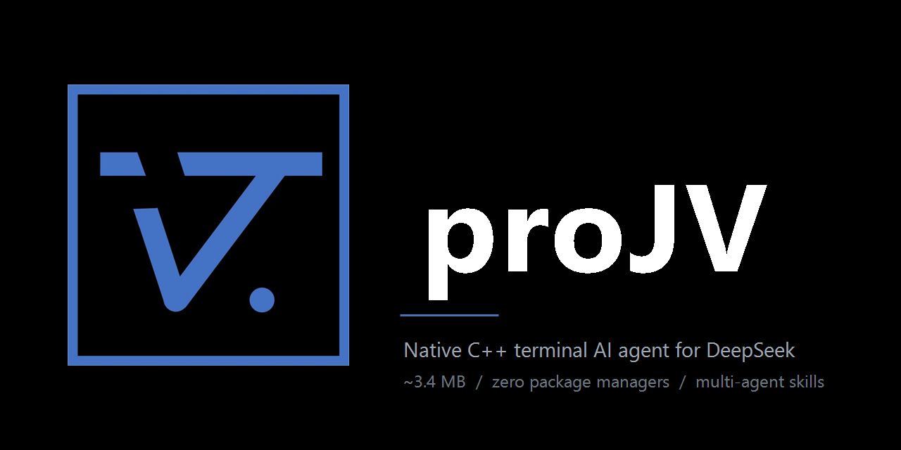
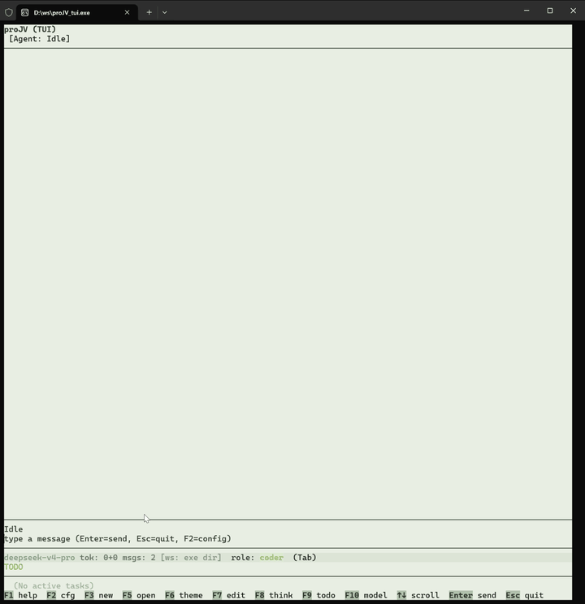

# proJV

  

**简体中文** | [English](README.md)

`proJV = Project Just Vibing` —— 用原生 C++ 写的终端 AI agent，基于 DeepSeek。

**proJV 的每一行代码都是 proJV 自己写的。**

---

## 三个不一样的地方

- **原生 C++，约 3.4 MB，零包管理器。** FTXUI + libcurl + SQLite 全部内置，
  一条 `cmake --build` 就得到一个可以 scp 走的单文件。
- **多 Agent 技能是数据，不是代码。** 一个技能就是一个文件夹：`config.json` +
  每个角色一份 `.md` + 动作工具的 schema。拷进去就能跑。主管可以在一条回复里把
  活派给十个并发执行的 worker。
- **每一层都能改。** 角色、工具、提示词、主题、压缩策略、Python 工具 —— 全是可
  执行文件旁边的纯文件，没有封闭生态。

---

## 三步用起来

1. **下载**对应平台的发布包并解压
   （[Releases](https://github.com/MilesKHuang/proJV/releases)；`proJV_tui` 与
   `projv_files/` 必须放在一起）。
2. **填 DeepSeek API Key**：首次启动的配置窗里粘贴
   （[在这里申请](https://platform.deepseek.com/api_keys)）。
3. **发一条消息**：让它读文件、改 bug，或者跑 `/monica D:\path\to\project`。

Windows 可能提示二进制未签名（SmartScreen ->「更多信息」->「仍要运行」）。
Linux 自行编译时需要 `libcurl4-openssl-dev`。

想自己编译？-> [安装指南](docs/zh/user-guide/01-install.md)

---

## 能做什么

| 能力 | 说明 |
|------|------|
| **工具调度** | 读写改文件、按行区间读取、目录树、正则搜索、shell、todo、技能 —— 由模型决定 |
| **技能** | `/monica <目录>`（十个 worker 并发整理项目）、`/bigbang`（三方圆桌辩论 -> 一份执行文档）、`skill_maker` 自动生成新技能 |
| **图片输入** | `@路径` 附加截图或图片；给目录会自动展开其中的图片 |
| **思考链** | 实时流式显示、可折叠，`F8` 看完整思考 |
| **网页** | DeepSeek 官方 Search / Fetch API（结构化结果、Markdown 页面） |
| **会话** | 每段对话一个 SQLite 库，崩溃不丢，`/compress` 压缩长对话 |
| **主题** | 2 个内置 + 6 套精选，可视化编辑器实时预览，JSON 导入导出 |
| **Python 工具** | 丢一个含 `tool.json` + `main.py` 的目录进去，agent 就能调 |
| **成本可见** | 实时 token 数与按 `config.toml` 价格表的费用估算 |

细节 -> [用户指南](docs/zh/user-guide/README.md) · [技能](docs/zh/user-guide/06-skills.md) · [pytool](docs/zh/user-guide/07-pytool.md)

---

## 横向对比

事实核实日期 2026-10-25；`—` 表示本文未核实。proJV 一列以本仓库代码为准。

| | proJV | Claude Code | OpenAI Codex CLI | Aider |
|---|---|---|---|---|
| 实现语言 | C++20 | TypeScript（Node） | Rust | Python |
| 安装方式 | 单文件二进制，依赖内置 | npm | npm / brew / Release | pip |
| 运行环境 | 无 | 需要 Node.js | 无（npm 只是外壳） | 需要 Python |
| 多 Agent | 数据驱动的技能文件夹，worker 并发执行 | subagents | TOML subagents | — |
| 扩展方式 | 丢文件：技能、角色、主题、Python 工具 | MCP、hooks | MCP、插件 | — |
| 模型选择 | 仅 DeepSeek | Anthropic | OpenAI | 多provider |
| 计费 | DeepSeek 按 token | 订阅或 API | ChatGPT 套餐或 API | 取决于 provider |

刻意做窄：proJV 只把一个模型服务商做好，并把扩展面放在纯文件里，而不是插件注册表。

---

## 下一步去哪

| 你想 | 去 |
|------|-----|
| 日常使用 | [用户指南](docs/zh/user-guide/README.md) |
| 跑 / 写技能 | [技能](docs/zh/user-guide/06-skills.md) |
| 改代码 | [开发指南](docs/zh/dev-guide/README.md) · [模块地图](docs/zh/dev-guide/module-map.md) · [改动配方](docs/zh/dev-guide/recipes.md) |
| 参与贡献 | [CONTRIBUTING_zh](CONTRIBUTING_zh.md) |

---

## 为什么这么选

**原生 C++ + 终端界面。** 体积小、没有运行时、SSH 和 tmux 里都能用，还能直接调
系统 API。真需要某个大库时，用 Python 工具补上。

**不做 MCP。** 这里的工具就是一个带 JSON schema 的结构体加一个函数。任何 MCP 能力
都能用几十行写成一个 pytool 或内置工具，中间不需要协议层。

**目前只接 DeepSeek。** 对一个整天读写文件的 agent 来说它足够便宜，多 Agent 才跑
得起。

---

## 致谢

[DeepSeek](https://deepseek.com) · [FTXUI](https://github.com/ArthurSonzogni/FTXUI)
· [SQLiteCpp](https://github.com/SRombauts/SQLiteCpp) · [libcurl](https://curl.se/)
· [loguru](https://github.com/emilk/loguru) · 以及所有让这一切成为可能的开源作者。

## 支持

如果 proJV 帮你省了时间，欢迎请我喝杯咖啡（微信）：

  

